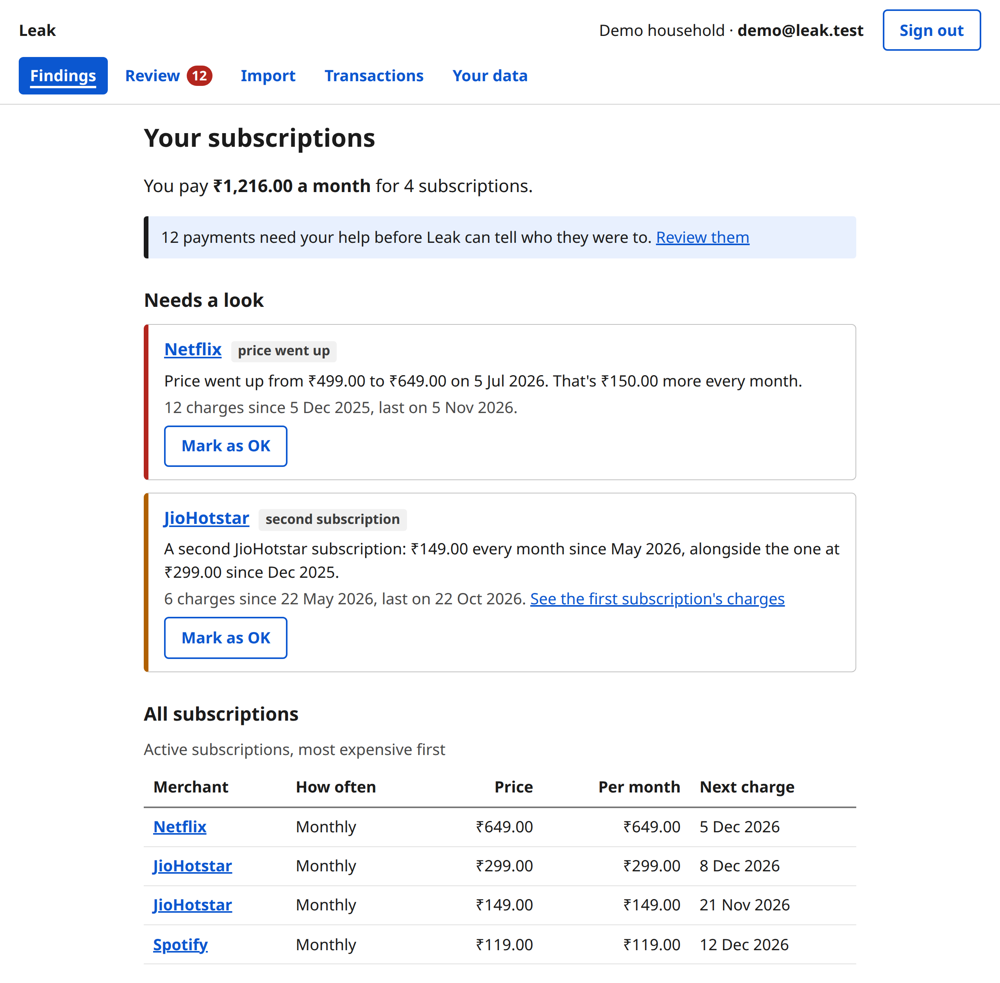
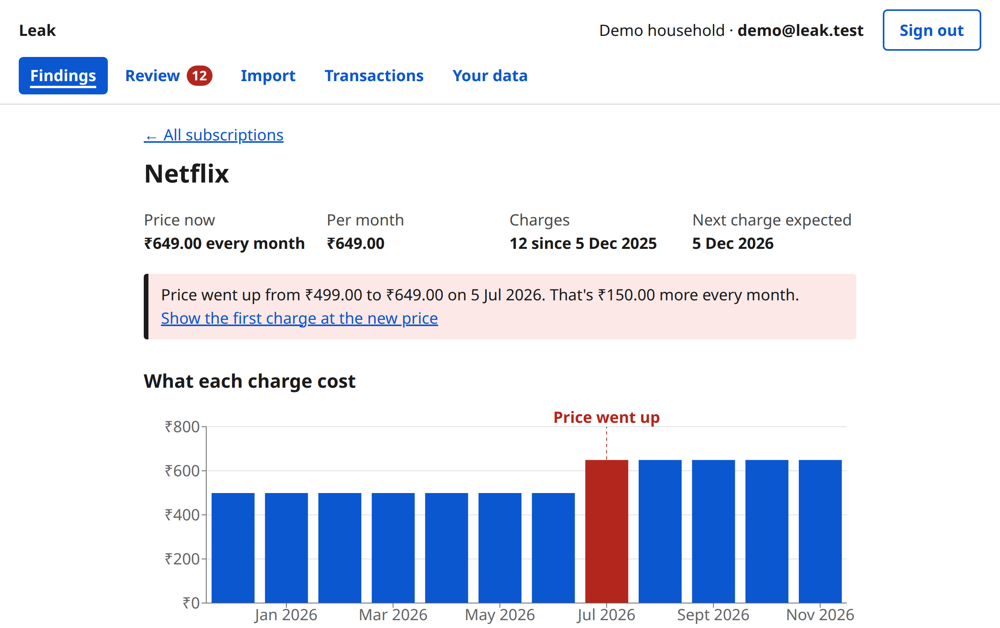
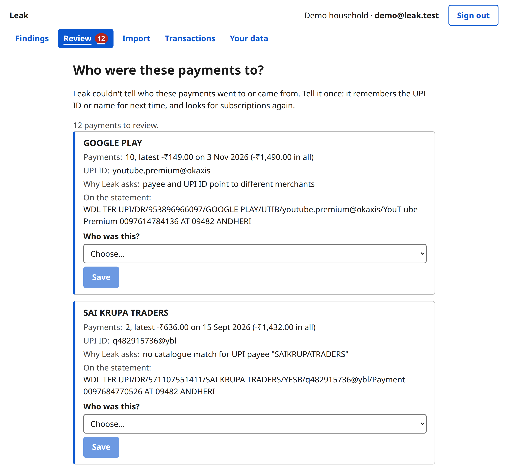
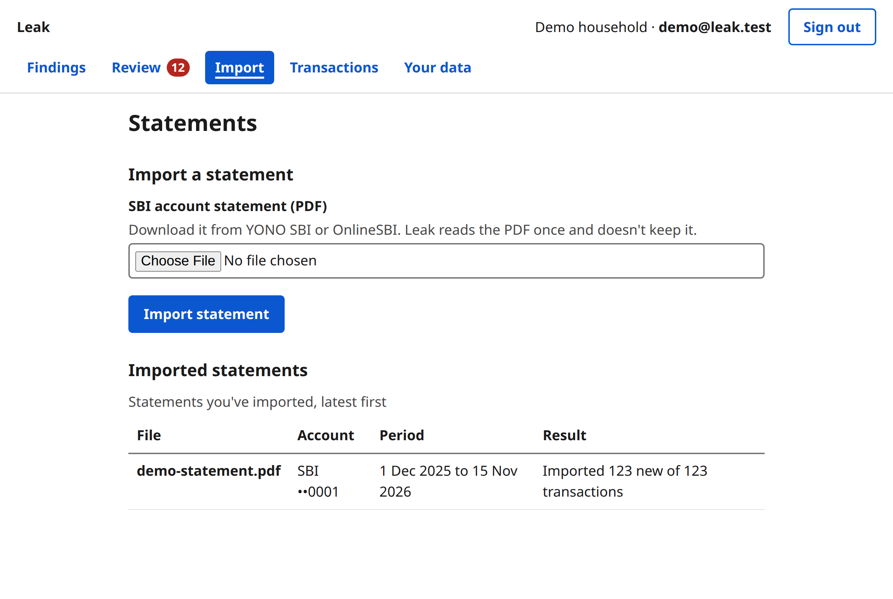
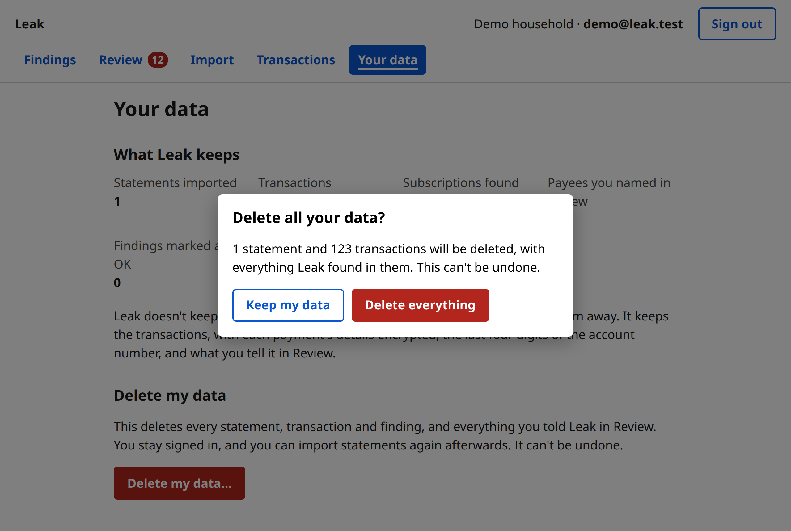
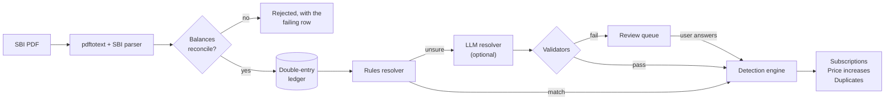
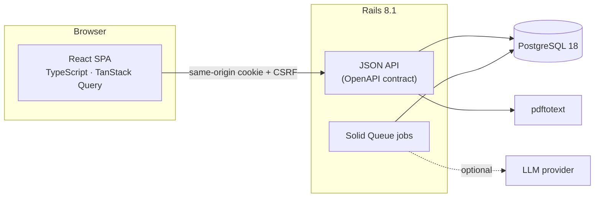
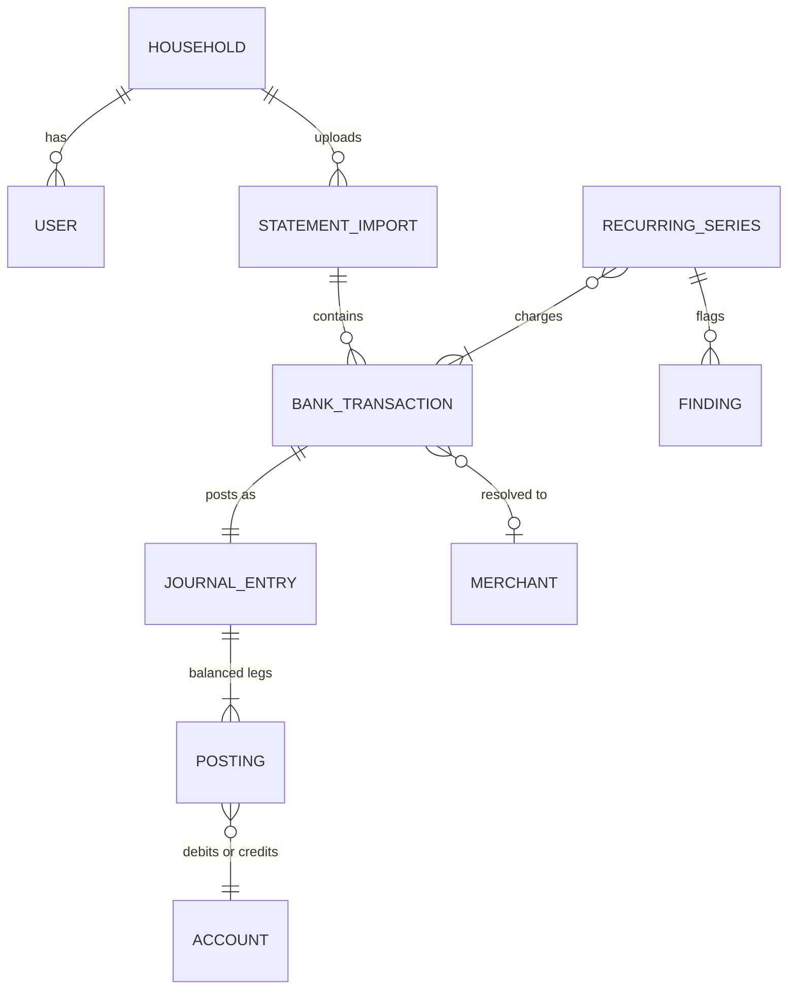
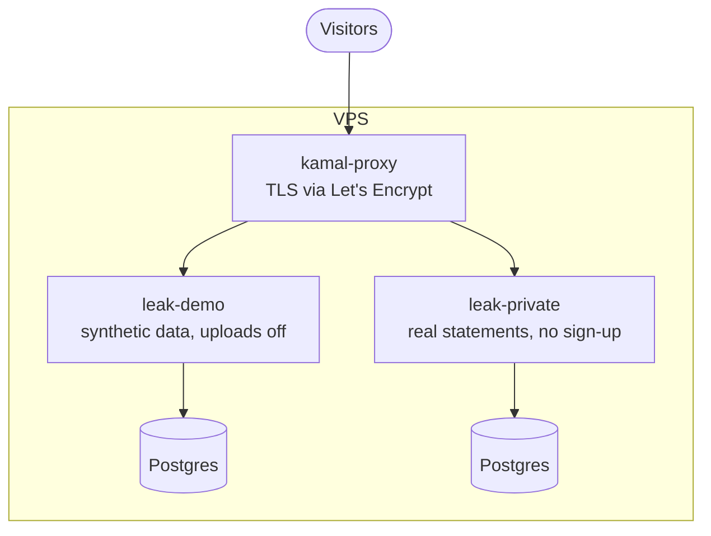

# Leak

**Find the subscriptions quietly draining a bank account, from the statements you already have.**

[](https://github.com/Sehaan-1/Leak/actions/workflows/ci.yml)


[](LICENSE)

Upload an SBI account statement and Leak shows what you pay every month in subscriptions, which ones got more expensive, and where you're paying for the same thing twice. Every number links back to the statement rows behind it.



## Features

- **Exact import.** SBI PDF statements are parsed with `pdftotext` and accepted only if every running balance reconciles to the paisa. Re-imports and overlapping statements are idempotent.
- **Merchant matching.** A rules engine over a catalogue of about 55 Indian merchants, then an optional LLM (any provider) whose answers must pass validators. Anything uncertain goes to a review queue, and each answer teaches Leak that payee.
- **Recurring-charge detection.** Finds subscriptions, price increases and second subscriptions, and ignores SIPs, EMIs, rent, insurance and everyday purchases.
- **Privacy first.** PDFs are never stored, narrations are encrypted at rest, and **Delete my data** erases everything in one step.
- **Public demo mode.** Each visitor gets a throwaway household of synthetic data. Uploads are disabled.

## Screenshots

| Price history and evidence | Review queue |
|---|---|
|  |  |
| **Statement import** | **Delete my data** |
|  |  |

<sub>All screenshots use the synthetic demo household.</sub>

## How it works



1. **Parse and reconcile.** Amounts, dates and balances come from a per-bank parser, never from an LLM. A statement that doesn't tie is rejected whole.
2. **Ledger.** Money is `bigint` paise in a double-entry journal. PostgreSQL enforces the invariants: balanced entries, append-only postings and same-household references.
3. **Resolve merchants.** Rules run strongest first: UPI ID, payee name, card and NACH text, then a `pg_trgm` match only when one merchant clearly wins. The LLM must quote evidence from the narration, and digit runs are masked before anything is sent.
4. **Detect.** Charges are chained per merchant and cadence. A confirmed new price is a **price increase**; a parallel chain at another price is a **second subscription**. All thresholds live in [`config/detection.yml`](config/detection.yml).

## Architecture



- **API contract:** [`openapi/openapi.yaml`](openapi/openapi.yaml) is the source of truth. Request specs validate every request and response against it, and the client's TypeScript types are generated from it.
- **SPA:** built by Vite and served by Rails, so the CSRF token is in the page and there's only one origin.



## Accuracy

Both components are measured on frozen synthetic test sets, and CI fails if a metric drops below its gate.

| Component | Test set | Result |
|---|---|---|
| Merchant matching (rules) | 300 narrations | **99.4%** accuracy [96.8–99.9%] at 76.3% coverage |
| Recurring-charge detection | 100 households, 50k transactions | **0.06** false flags per 100 charges [0.04–0.08] |
| | | Series: 97.9% precision, 95.7% recall |
| | | Price increases: 100% precision, 92% recall |
| | | Duplicates: 100% precision, 100% recall |

Synthetic scores are an upper bound on real-world accuracy. See [`eval/`](eval) for the generators and methodology.

## Getting started

**Requirements:** Ruby 4.0.10, PostgreSQL 18, `poppler-utils`, Node 22.12+.

```sh
bin/setup --skip-server   # gems, web dependencies, database
bin/rails db:seed        # demo household: demo@leak.test / demo-password-change-me
bin/dev                  # Rails on :3000, Vite on :5173
```

Open <http://localhost:5173>, sign in with the demo account, and import [`spec/fixtures/synthetic/sbi/sample_statement.pdf`](spec/fixtures/synthetic/sbi/sample_statement.pdf). Run `LEAK_DEMO=1 bin/dev` to try the public demo mode.

| Command | |
|---|---|
| `bin/ci` | Everything CI runs, locally |
| `bin/rails 'leak:import[file.pdf,user@example.com]'` | Import a statement from the command line |
| `bin/rails 'leak:eval:merchants[golden]'` | Merchant-matching eval (`[dev]` lists every miss) |
| `bin/rails 'leak:eval:detection[golden]'` | Detection eval |
| `bin/rails leak:llm:check` | Show which LLM provider is in use and make one test call |

### LLM provider

The LLM step is optional. Without it, rows the rules can't decide go to the review queue. Configure it with environment variables or `bin/rails credentials:edit`; see [`config/llm.yml`](config/llm.yml).

| You have | Set |
|---|---|
| Any OpenAI-compatible API | `LLM_BASE_URL`, `LLM_MODEL`, `LLM_API_KEY` |
| A preset provider | `LLM_PROVIDER=gemini\|nvidia\|openai\|openrouter\|groq\|ollama` and its key |
| `agy` or `opencode` installed | Nothing, they're detected automatically |
| A free key | `GEMINI_API_KEY` or `NVIDIA_API_KEY` |

> [!IMPORTANT]
> Payee names are sent to the provider, and free tiers may train on them. For real statements, use a paid tier or a local model (`ollama`).

## Deployment

Two instances from one image with [Kamal 2](https://kamal-deploy.org): a public demo and a private instance for real statements.



```sh
bin/rails 'leak:secrets[private]'   # generate secrets, then export them
bin/kamal setup -d private          # first deploy
bin/kamal deploy -d private         # afterwards
```

See [docs/deployment.md](docs/deployment.md) for server setup, environment variables and account management.

### Deploy for Free

Deploy to [Render](https://render.com) for free with a single click:

[](https://render.com/deploy?repo=https://github.com/Sehaan-1/Leak)

Or run locally with Docker Compose:

```sh
docker compose up -d
```
Visit `http://localhost:8080`.

## Privacy

- Real statements never enter git, fixtures, screenshots or LLM logs. Seeds, tests and the demo use synthetic data only.
- Uploaded PDFs are read once and discarded. Narrations and references are encrypted with Active Record Encryption, and only the account number's last four digits are kept.
- The public demo refuses uploads and deletes every visitor's household after 24 hours.

## Testing

CI runs on every change: RuboCop, Brakeman and bundler-audit; RSpec, including raw-SQL attacks on the ledger invariants; both evaluation gates; Biome, TypeScript and Vitest; a Playwright end-to-end test; and a smoke test of the production Docker image.

## Design notes

<details>
<summary>Why things are built the way they are</summary>

- [Money is integer paise](docs/design/integer-paise.md)
- [Double-entry ledger with database-enforced invariants](docs/design/double-entry-ledger.md)
- [Same-origin cookie sessions, not JWT](docs/design/cookie-session-auth.md)
- [OpenAPI file as the API contract](docs/design/openapi-contract.md)
- [Statement import: exact parsing, reconciliation, fingerprints](docs/design/statement-import.md)
- [The SPA is served by Rails, built by Vite](docs/design/spa-served-by-rails.md)
- [Rules-first merchant resolution](docs/design/rules-merchant-resolution.md)
- [LLM merchant resolution](docs/design/llm-merchant-resolution.md)
- [Recurring-charge detection](docs/design/recurring-charge-detection.md)
- [Review queue and dismissals](docs/design/review-queue-and-dismissals.md)
- [Deployment and the public demo](docs/design/deploy-and-public-demo.md)
- [Delete my data](docs/design/delete-my-data.md)

</details>

## License

[MIT](LICENSE)
